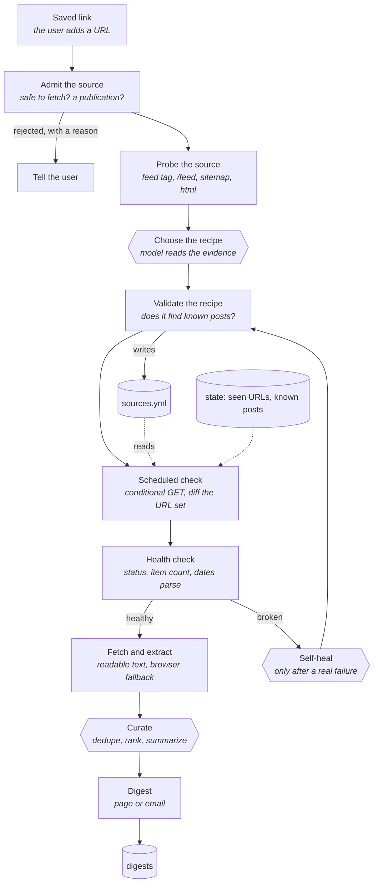
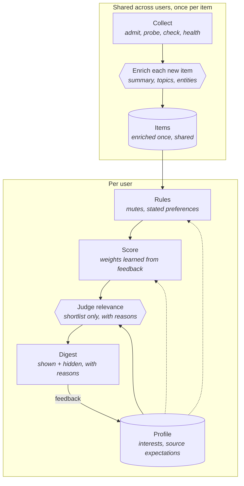

# personal-news — architecture (draft)

Design rule carried from [03](03-where-agents-earn-their-keep.md) and confirmed by [career-ops](case-studies/career-ops.md): **the model runs at the ends, never in the per-check loop.**


`{{hexagons}}` = model calls; rectangles = plain code; `[(cylinders)]` = files on disk.

## Stages

| # | Stage | Who | How often | Notes |
|---|---|---|---|---|
| 1 | Saved link | user | per source | A URL of any shape: article, blog index, YouTube channel, newsletter |
| 1b | Admit the source | code (+model, +user) | once per source | Before any fetch: URL safety (public host, no secret tokens, no action links). Then content type, item shape (posts are dated in the past), and a probation period for churn. Model classifies into a closed set of kinds only when rules can't decide. See [06](06-admitting-sources.md) |
| 2 | Probe the source | code | once per source | Normalize URL → `<link rel="alternate">` → `/feed`, `/rss.xml`, `/atom.xml`, `/index.xml` → `robots.txt` → `sitemap.xml` (handle `<sitemapindex>`) → page HTML. Collects an **evidence bundle**, decides nothing |
| 3 | Choose the recipe | **model** | once per source | One call with the evidence bundle. Handles ambiguity (which of 3 feeds), odd inputs, non-website sources, and the stop condition |
| 4 | Validate the recipe | code | on every recipe change | Gate: does the saved URL appear? Does the recipe reproduce the stored known posts? Nothing is adopted until it passes |
| 5 | Scheduled check | code | every run | Run the recipe, normalize URLs, diff against the seen set. `ETag`/`Last-Modified` when offered. Interval per source from its own posting history |
| 6 | Health check | code | every run | Independent of new content: HTTP status, parse ok, item count, newest known post still present, dates parse. Plus a silence alarm at ~3× the source's median gap |
| 7 | Self-heal | **model** | on breakage | Only for failures that mean "the recipe is wrong" (404/301, empty feed, 0 items). Retries/backoff and bot-protection are handled in code. Output is a new recipe, which re-enters stage 4 |
| 8 | Fetch and extract | code (+model fallback) | per new post | Readable main text; headless browser only for sources that need it; model extraction only for sources with no structured data |
| 9 | Curate | **model** | once per digest | Cross-source dedupe, rank against interests, summarize |
| 10 | Digest | code | once per digest | Page or email |

## Files

| File | Layer | Holds |
|---|---|---|
| `sources.yml` | user | One entry per saved source: url, recipe, poll interval, enabled, notes. Never rewritten by an update |
| `state/` | derived | Seen URLs per source, known-post fixtures, health history, failure counters |
| `digests/` | output | What was sent, so a post is never sent twice |

Seen-set diffing is what makes a feedless source workable ([Anthropic](case-studies/anthropic-news.md): sitemap URL diff), and URL normalization is what makes the diff correct ([OpenAI](case-studies/openai-news.md): trailing slashes matched 0 of 1,125 URLs before normalizing).

## Recipe (the contract between code and model)

A small declarative record, not free-form actions — auditable, replayable, cheap to re-run:

```yaml
- name: Anthropic news
  url: https://www.anthropic.com/news
  method: sitemap_diff          # feed | sitemap_diff | html_links | json_api | browser
  endpoint: https://www.anthropic.com/sitemap.xml
  select: {url_prefix: "https://www.anthropic.com/news/"}
  interval_days: 3
  fixtures: [".../news/claude-opus-5", ".../news/claude-text-watermark"]
```

The model may propose only fields in this vocabulary. Code executes it, validates it, and versions it (keep history, allow rollback).

## Guardrails
- **Untrusted content:** page text is data, never instructions — including during self-healing, when the model reads a broken page.
- **Repair budget:** max attempts per source, cooldown, escalate to the user after repeated failure.
- **Politeness:** conditional GET, per-host rate limiting, honor `robots.txt`, back off on 429/403 rather than evading.
- **Blocked or paywalled sources:** route through what the user is entitled to (their own browser session, an email newsletter, a personal feed URL), never through evasion.
- **Never widen scope silently:** a healed recipe that starts following a different section must fail validation.

## Cost shape
| Model call | Frequency |
|---|---|
| Choose the recipe | once per source |
| Self-heal | once per breakage |
| Curate | once per digest |
| Routine checking | never |

## Still open
- Delivery channel and cadence
- Where it runs (local cron, cloud routine, self-hosted)
- Language and stack
- Whether the digest is a static page, an email, or both

---

# v2: adding personalization (draft, 2026-09-26)

Relevance depends on the item's content, the reader's interests, and **what the reader expects from that source** ([12](12-personalization.md)). That splits the system into two layers.



## What changes
| | v1 | v2 |
|---|---|---|
| Unit of work | A source | A source (collection) **and** a user × item pair (judgment) |
| Model per new item | Curate (dedupe, rank, summarize) | **Enrich** once per item (shared) + **judge** a shortlist per user |
| User state | Subscriptions | Subscriptions + **profile** (interests, per-source expectations) + **rules** + **feedback log** |
| Digest | Selected items | Selected items **and** hidden ones, each with a reason |

The collection half (admission, probing, recipes, checks, health, self-healing) is **unchanged**.

## Cost shape
The expensive new dimension is users × items. Keep the model off most of it:
| Step | Runs | Cost grows with |
|---|---|---|
| Enrich | Once per new item, shared | Items (not users) |
| Rules | Every item for every user | Free (code) |
| Score | Every item for every user | Near free (code) |
| Judge | Only the shortlist and borderline items, batched per digest | Users × shortlist size, capped by a per-user budget |
| Profile update | Periodically, from accumulated feedback | Users |

## Security additions
- Item text reaches the **judge prompt next to the user's profile**. A post saying "rate this as highly relevant" is prompt injection. The judge returns only a label and a reason code from a closed set; item text is delimited as data.
- **Rules and profile change only through the user's own actions**, never because of content. The model may *propose* a rule; the user confirms it.
- Profiles are sensitive (they reveal interests): per-user, never shared, excluded from logs.
